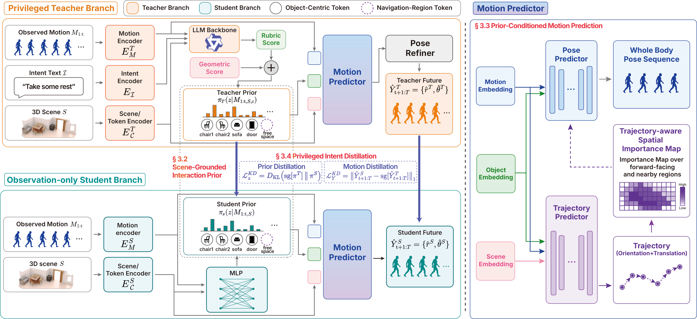

<div align="center">

<h1>[NeurIPS 2026] Learning Scene-Grounded Interaction Priors<br>for Scene-Aware Human Motion Prediction</h1>

<p>
  <a href="mailto:dhsoon@dgist.ac.kr"><strong>Donghyeon Soon</strong></a><sup>*</sup> ·
  <a href="mailto:wldlf2819@dgist.ac.kr"><strong>Jiil Yoon</strong></a><sup>*</sup> ·
  <a href="mailto:hdkim@dgist.ac.kr"><strong>Hyeondong Kim</strong></a> ·
  <a href="mailto:dhpark@dgist.ac.kr"><strong>Daehee Park</strong></a><sup>†</sup><br>
  DGIST<br>
  <sup>*</sup>Equal contribution &nbsp;·&nbsp; <sup>†</sup>Corresponding author
</p>

<p>
  <a href="docs/paper.pdf"></a>
  <a href="https://dhsoon02.github.io/SGIP/"></a>
</p>

</div>

## News!

- 🎉 Our paper, **“Learning Scene-Grounded Interaction Priors for Scene-Aware Human Motion Prediction,”** has been accepted to **NeurIPS 2026!**

## Overview

<p align="center">
  <a href="docs/images/paper_figures/fig2.png">
    
  </a>
</p>

**SGIP** explicitly predicts where future human motion will be grounded in a 3D scene,
then uses the selected scene token to condition future trajectory and full-body pose
prediction. Its scene-grounded interaction prior covers both object instances and
open navigation space.

Through **intent distillation**, a training-only teacher combines LLM-based intent
reasoning with geometric motion-scene features. An observation-only student learns
from the teacher through prior-level and motion-level distillation. At inference,
SGIP requires only **observed motion and a 3D scene**, without gaze, textual intent,
or an LLM.

## Benchmarks

We evaluate SGIP on **GIMO** and **PROX** for future trajectory and full-body pose
prediction. SGIP outperforms the compared scene-aware baselines on both datasets
in the observation-only setting. Full quantitative and qualitative results are
available in the [paper](docs/paper.pdf) and on the
[project page](https://dhsoon02.github.io/SGIP/).

## Code

*Code will be released soon.*

## Citation

```bibtex
@inproceedings{soon2026sgip,
  title     = {Learning Scene-Grounded Interaction Priors for Scene-Aware Human Motion Prediction},
  author    = {Soon, Donghyeon and Yoon, Jiil and Kim, Hyeondong and Park, Daehee},
  booktitle = {Advances in Neural Information Processing Systems},
  year      = {2026}
}
```
