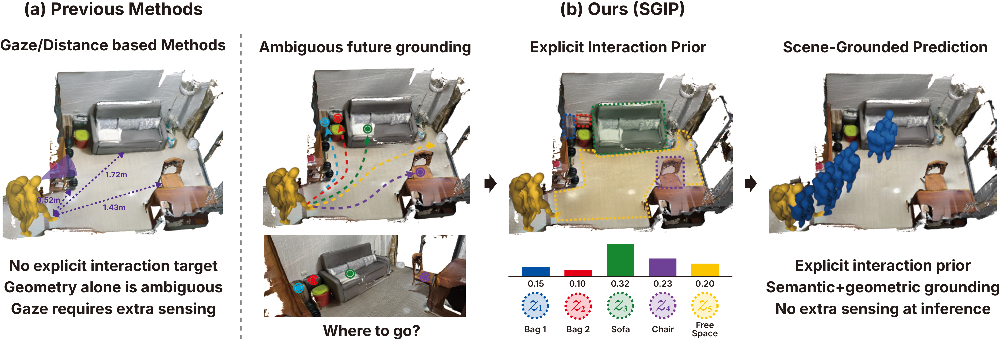
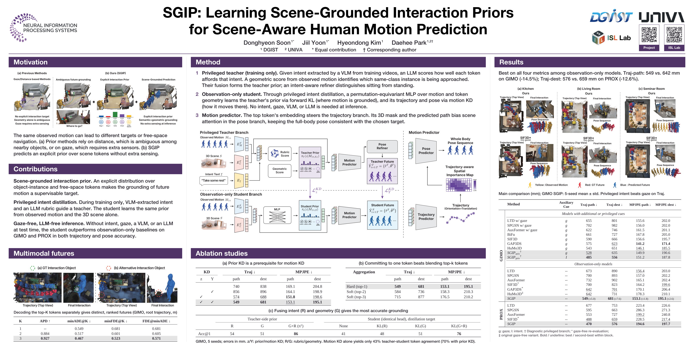

<div align="center">

<h1>SGIP: Learning Scene-Grounded Interaction Priors<br>for Scene-Aware Human Motion Prediction</h1>

<p><strong>NeurIPS 2026</strong></p>

<p>
  <a href="https://dhsoon02.github.io/"><strong>Donghyeon Soon</strong></a><sup>1*</sup> ·
  <a href="https://yoon-ji-il.github.io/"><strong>Jiil Yoon</strong></a><sup>1*</sup> ·
  <a href="https://www.hyeondong.kim/"><strong>Hyeondong Kim</strong></a><sup>1</sup> ·
  <a href="https://sites.google.com/view/dhpark/"><strong>Daehee Park</strong></a><sup>1,2†</sup><br>
  <sup>1</sup>DGIST &nbsp;·&nbsp; <sup>2</sup>UNIVA<br>
  <sup>*</sup>Equal contribution &nbsp;·&nbsp; <sup>†</sup>Corresponding author
</p>

<p>
  <a href="docs/paper.pdf"></a>
  <a href="https://sgip2026.github.io/"></a>
  <a href="docs/images/SGIP_Poster_Preview.png"></a>
  <a href="https://neurips.cc/virtual/2026/loc/sydney/poster/152697"></a>
</p>

</div>

<p align="center">
  <a href="docs/images/paper_figures/teaser_camready.pdf">
    
  </a>
</p>

**TL;DR** Given observed motion and a 3D scene, **SGIP** predicts an explicit interaction
prior over objects and open space to guide future trajectory and full-body pose
prediction. Intent distillation transfers training-time guidance from an intent-aware
teacher to an observation-only student, with **no gaze, textual intent, or LLM at inference**.

## 📢 News

- 🎉 SGIP is accepted to **NeurIPS 2026!** See you in Sydney!
- **Code release:** Code and pretrained checkpoints will be released soon. Please ⭐ star or watch this repository for updates.

## 🗂️ Release Plan

- [ ] Inference code
- [ ] Pretrained checkpoints
- [ ] Training code
- [ ] Data preprocessing and evaluation instructions

## Poster

<p align="center">
  <a href="docs/images/SGIP_Poster_Preview.png">
    
  </a>
</p>

[View full-resolution poster](docs/images/SGIP_Poster_Preview.png).

## 📖 Citation

```bibtex
@inproceedings{soon2026sgip,
  title     = {Learning Scene-Grounded Interaction Priors for Scene-Aware Human Motion Prediction},
  author    = {Soon, Donghyeon and Yoon, Jiil and Kim, Hyeondong and Park, Daehee},
  booktitle = {Advances in Neural Information Processing Systems},
  year      = {2026}
}
```
